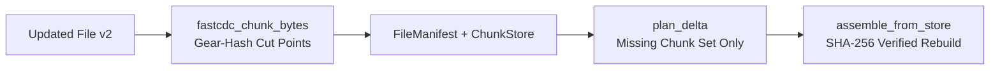

# cdc-delta

[](https://github.com/codesphere-u/cdc-delta/actions/workflows/ci.yml)
[](LICENSE)
[](pyproject.toml)
[](pyproject.toml)

**Bandwidth-miserly pure-Python Gear-hash FastCDC content-defined chunker, atomic SHA-256 resumable chunk store, and shift-invariant delta-patch sync engine for intermittent 2G/3G links.**

- **Mission Domain:** Internet Infrastructure & Offline Edge Sync
- **Stack:** Pure Python 3.11+ (zero runtime third-party dependencies, `mypy --strict`, `ruff`, `pytest`)
- **Maintainer:** Codesphere Innovations (U) Limited (`codesphere-u`)

---

## Problem Solved

Syncing updated datasets, offline educational bundles, or software archives over drop-prone 50–200 kbps 2G/3G connections fails with fixed-block hashing whenever bytes are inserted near the start of a file.

## Key Features

- Normalized Gear-hash FastCDC (Xia et al., USENIX ATC '16) content-defined chunking resilient to front/mid-file byte shifts.
- Atomic SHA-256 content-addressed `ChunkStore` verifying integrity on every read to catch silent disk/link corruption.
- Resumable `plan_delta` diffing achieving >90% verified bandwidth savings on updated binary archives plus whole-file SHA-256 verified assembly.

## Architecture Overview



See [docs/architecture.md](docs/architecture.md) for module-level design details.

## Installation

```bash
git clone https://github.com/codesphere-u/cdc-delta.git
cd cdc-delta
uv sync --extra dev
```

Or install in editable mode with standard `pip`:

```bash
pip install -e ".[dev]"
```

## Quick Start (CLI)

```bash
cdc-delta demo
```

## Quick Start (Python API)

```python
import tempfile
from cdc_delta import ChunkStore, assemble_from_store, build_manifest, plan_delta

with tempfile.TemporaryDirectory() as d:
    s = ChunkStore(d)
    m = build_manifest(b"hello" * 5000, store=s)
    assert plan_delta(m, s).bytes_to_transfer == 0
    assert assemble_from_store(m, s) == b"hello" * 5000
```

## Testing & Quality Gates

```bash
uv run ruff check src tests
uv run mypy src
uv run pytest -v
```

## Security, Contributing & Roadmap

- **Security:** See [SECURITY.md](SECURITY.md) for responsible disclosure procedures.
- **Contributing:** See [CONTRIBUTING.md](CONTRIBUTING.md) and [CODE_OF_CONDUCT.md](CODE_OF_CONDUCT.md).
- **Changelog & Roadmap:** See [CHANGELOG.md](CHANGELOG.md) and [ROADMAP.md](ROADMAP.md).

## License

MIT License — see [LICENSE](LICENSE).

## Support & Contact

Open an issue on [GitHub Issues](https://github.com/codesphere-u/cdc-delta/issues) or contact `codesphereinnovationz@gmail.com`.
